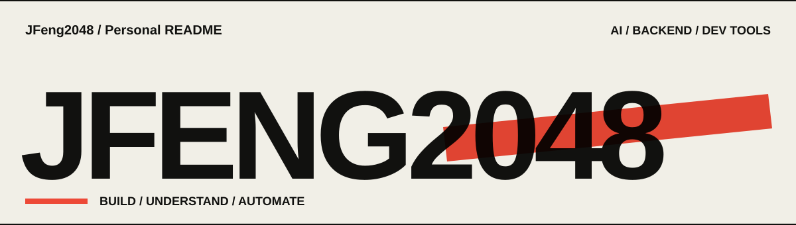
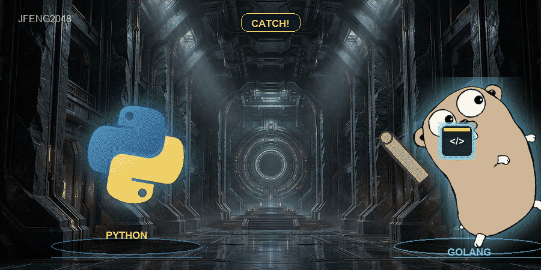
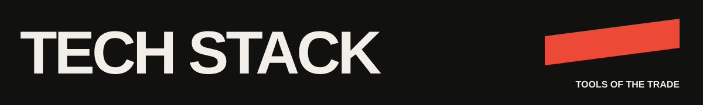

<table>
  <tr>
    <td width="170"><strong>Languages</strong></td>
    <td>
      
      
    </td>
  </tr>
  <tr>
    <td><strong>Backend & AI</strong></td>
    <td>
      
      
      
      
      
      
      
    </td>
  </tr>
  <tr>
    <td><strong>Frontend & Desktop</strong></td>
    <td>
      
      
      
    </td>
  </tr>
  <tr>
    <td><strong>Database & Infrastructure</strong></td>
    <td>
      
      
      
      
      
      
    </td>
  </tr>
</table>

---

<table>
  <tr><th width="100" align="left">ROUND</th><th align="left">PROJECT / SPECIAL MOVE</th></tr>
  <tr>
    <td></td>
    <td><strong><a href="https://github.com/ncepu-iDealStudio/Fast-Https">Fast-Https</a></strong> 轻量级 Web 服务器与反向代理。单二进制、JSON 配置、HTTP/2、自动 HTTPS，RPC 与 WebSocket 一并拿下。 </td>
  </tr>
  <tr>
    <td></td>
    <td><strong><a href="https://github.com/ncepu-iDealStudio/.ncepu_ideal-skills">.ncepu_ideal-skills</a></strong> 「模板＋配置＋规范」驱动，把 SQL / MySQL DDL 变成 FastAPI、Flask、Gin 项目脚手架，支持增量更新。  </td>
  </tr>
  <tr>
    <td></td>
    <td><strong><a href="https://github.com/JFeng2048/agent-design-skills">agent-design-skills</a></strong> 把 Agent 设计方法做成可复用 Skill：系统提示词、状态栏、用户记忆、RAG 管线，一套流程直接复用。 </td>
  </tr>
  <tr>
    <td></td>
    <td><strong><a href="https://github.com/JFeng2048/Wslc-Desktop">Wslc-Desktop</a></strong> Windows 上的 WSL 容器管理台。容器、镜像、卷、网络，一屏搞定；少敲命令，多点确定。 </td>
  </tr>
  <tr>
    <td></td>
    <td><strong><a href="https://github.com/JFeng2048/museflow">museflow</a></strong> 微服务智能小说生成平台：数据爬取 → RAG 增强 → 异步调度 → 多平台发布，一条龙打通。  </td>
  </tr>
</table>

---

